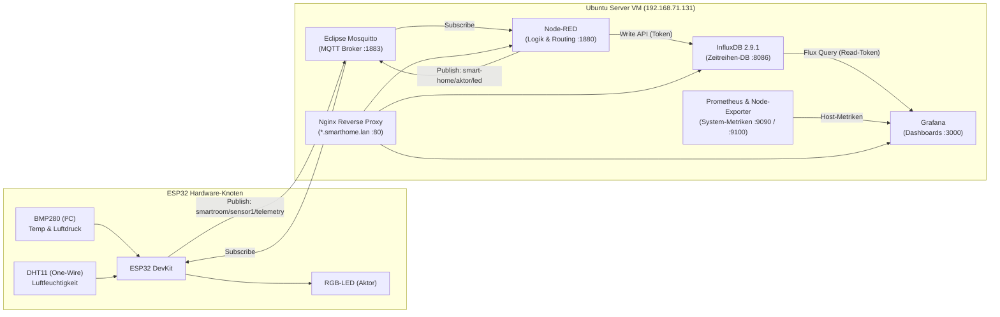
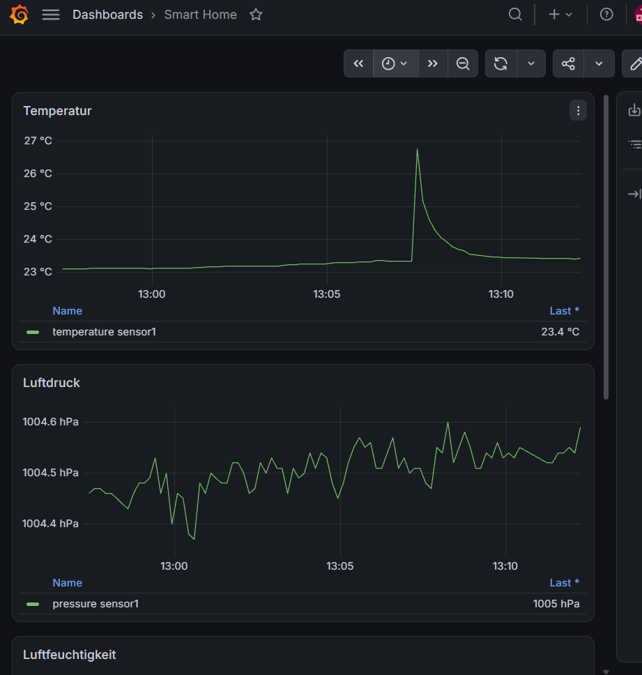
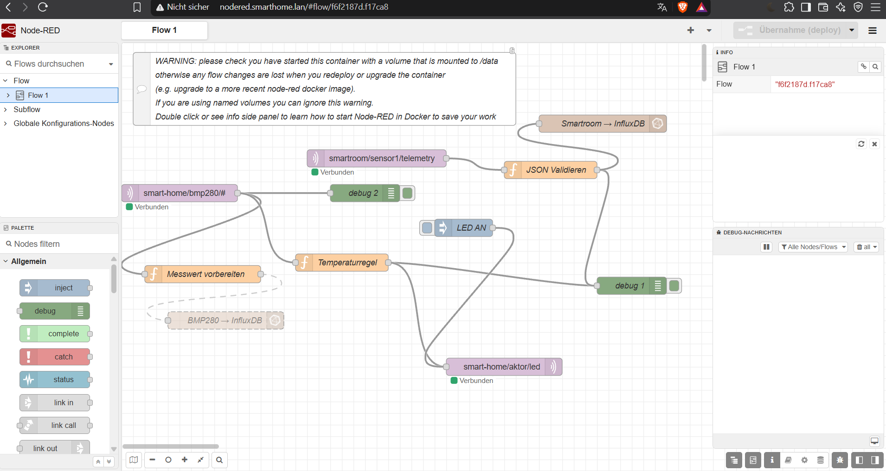
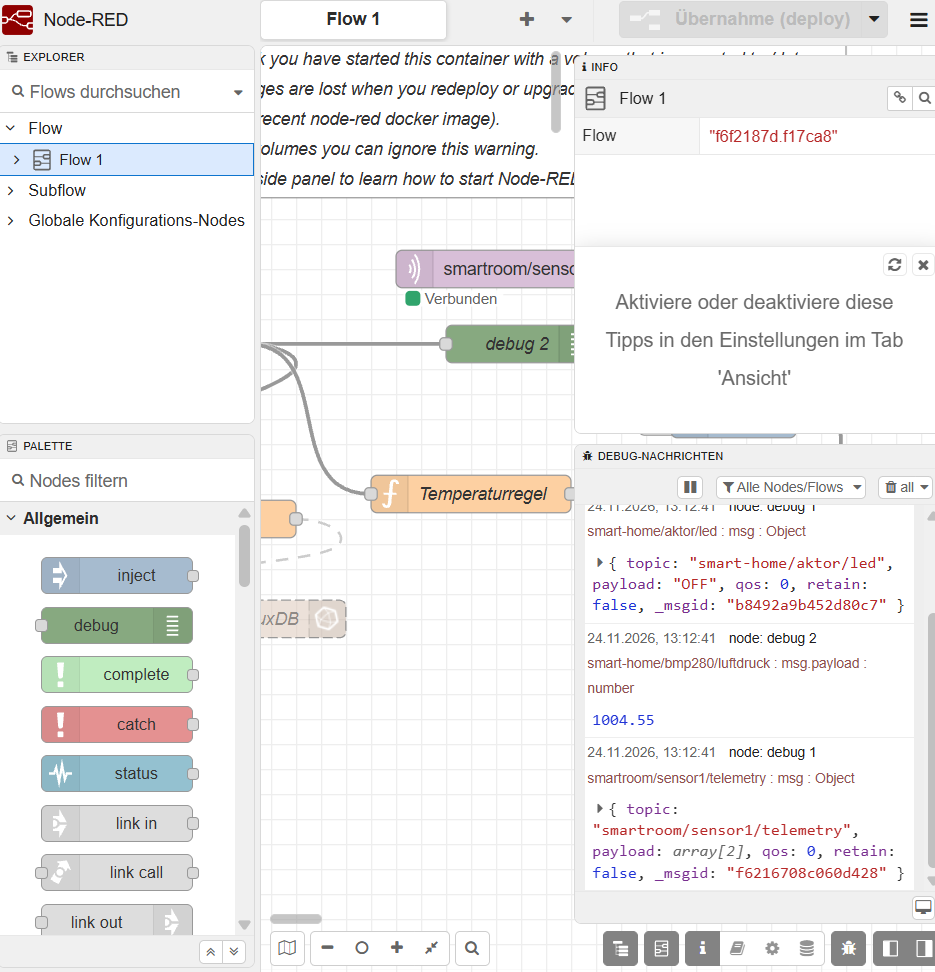
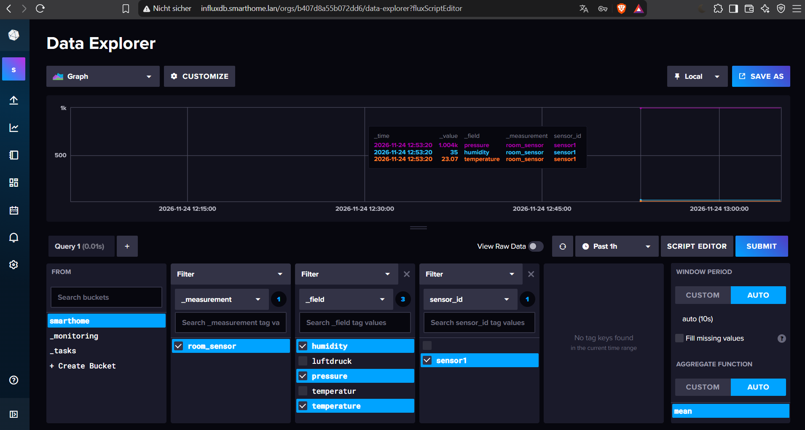
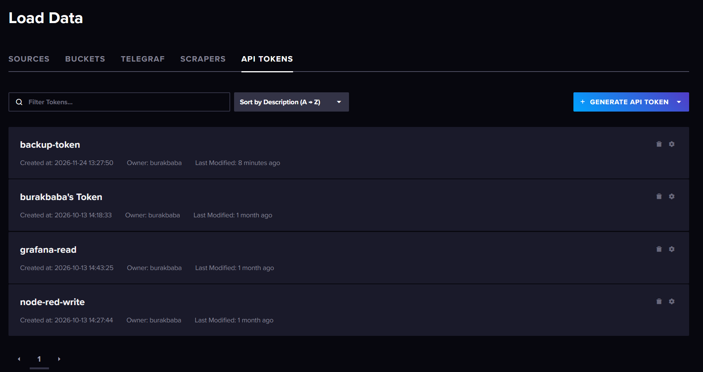
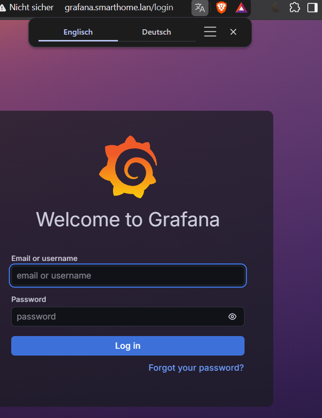

# Smart Home Monitoring & Steuerungssystem (SYT-Projekt)

Vollständige IoT- und Server-Infrastruktur zur Erfassung, Verarbeitung, Speicherung und Visualisierung von Umgebungsdaten (Temperatur, rel. Luftfeuchtigkeit, Luftdruck) sowie Aktorik-Steuerung im Rahmen des SYT-Unterrichts (HTL Wien).

---

## Inhaltsverzeichnis
1. [Systemarchitektur & Datenfluss](#1-systemarchitektur--datenfluss)
2. [Hardware-Aufbau & Sensoren](#2-hardware-aufbau--sensoren)
3. [Virtualisierung, Netzwerk & Software-Versionen](#3-virtualisierung-netzwerk--software-versionen)
4. [Automatisierung & Infrastructure-as-Code (Ansible)](#4-automatisierung--infrastructure-as-code-ansible)
5. [Sicherheitskonzept](#5-sicherheitskonzept)
6. [Datensicherung & Wiederherstellung (Backup & Restore)](#6-datensicherung--wiederherstellung-backup--restore)
7. [Abnahme- & Testprotokoll (T01 – T07)](#7-abnahme---testprotokoll-t01--t07)
8. [Screenshots & Bildnachweise](#8-screenshots--bildnachweise)
9. [Repository-Struktur](#9-repository-struktur)
10. [Schnellstart & Installation](#10-schnellstart--installation)

---

## 1. Systemarchitektur & Datenfluss

Das System verbindet einen **ESP32-Mikrocontroller** (Sensoren & RGB-LED Aktor) über **MQTT** mit einer **Ubuntu Server VM**. Dort laufen containerisierte Dienste zur Datenverarbeitung, Speicherung, Visualisierung und Systemüberwachung.



---

## 2. Hardware-Aufbau & Sensoren

| Komponente | Schnittstelle / Pin | Funktion & Messbereich |
| :--- | :--- | :--- |
| **ESP32 DevKit** | Micro-USB / WLAN 2.4 GHz | Steuerungs-Mikrocontroller, WiFi-Client, MQTT-Publisher & -Subscriber |
| **BMP280** | I²C (SDA: GPIO 21, SCL: GPIO 22) | Temperatur (-40 bis +85 °C) & Luftdruck (300 bis 1100 hPa) |
| **DHT11** | Digital / One-Wire (GPIO 32) | Relative Luftfeuchtigkeit (20 % bis 90 % rF) |
| **RGB-LED** | Gemeinsame Kathode an GND, Rot: GPIO 25, Grün: GPIO 26, Blau: GPIO 27 | Optischer Aktor: Schaltet bei Schwellwertüberschreitung (> 26,0 °C) auf Rot |

### MQTT-Topics & Datenmodell

* **Telemetrie-Topic** (`ESP32` → `Mosquitto`): `smartroom/sensor1/telemetry` (Sendeintervall: 10 Sekunden)
  ```json
  {
    "temperature": 23.83,
    "humidity": 38.0,
    "pressure": 1004.35
  }
  ```
* **Aktorik-Topic** (`Node-RED` → `ESP32`): `smart-home/aktor/led` (`ON` / `OFF`)
* **InfluxDB-Datenmodell**:
  * **Bucket**: `smarthome`
  * **Measurement**: `room_sensor`
  * **Tag**: `sensor_id="sensor1"`
  * **Fields**: `temperature` (float), `humidity` (float), `pressure` (float)

---

## 3. Virtualisierung, Netzwerk & Software-Versionen

### Netzwerk-Topologie
Die Ubuntu-Server-VM in VMware Workstation nutzt ein Dual-NIC-Setup zur sauberen Trennung:
* **`ens33` (192.168.71.131/24)**: Host-Only / Management-Netzwerk für Browserzugriff auf Web-UIs (Grafana, Node-RED, InfluxDB, Portainer) und Administration via SSH.
* **`ens37` (172.20.10.3/28)**: Sensor-WLAN / Hotspot-Netzwerk zur direkten Kommunikation mit dem ESP32.

### Lokale Namensauflösung & Nginx Reverse Proxy
Über Nginx Reverse Proxy (`nginx:1.30.6-alpine`) werden alle Weboberflächen auf Standard-Port 80 über saubere lokale Domains bereitgestellt:
* `http://grafana.smarthome.lan` → Grafana (`:3000`)
* `http://nodered.smarthome.lan` → Node-RED (`:1880`)
* `http://influxdb.smarthome.lan` → InfluxDB (`:8086`)

### Software-Versionen

| Komponente | Version / Container-Image | Aufgabe im System |
| :--- | :--- | :--- |
| **Host-Betriebssystem** | Ubuntu Linux (Kernel 7.0.0-38-generic x86_64) | Basis-Betriebssystem der Server-VM |
| **Docker Engine** | 29.1.3 | Container-Laufzeitumgebung |
| **Docker Compose** | v2.40.3 | Orchestrierung der Multi-Container-Stacks |
| **Ansible** | core 2.20.1 | Automatisierte Server-Provisionierung (IaC) |
| **Eclipse Mosquitto** | `eclipse-mosquitto:latest` | MQTT-Message-Broker (Port 1883) |
| **Node-RED** | `nodered/node-red:latest` | Datenverarbeitung, Validierung & Schwellwertlogik |
| **InfluxDB** | `influxdb:2.9.1-alpine` | Zeitreihendatenbank für Sensordaten (Port 8086) |
| **Grafana** | `grafana/grafana:latest` | Live-Dashboards & Visualisierung (Port 3000) |
| **Nginx** | `nginx:1.30.6-alpine` | Reverse Proxy für lokale Domains (Port 80) |
| **Prometheus / Node-Exporter** | `prom/prometheus` / `node-exporter` | Host- und Systemressourcen-Monitoring |
| **Portainer** | `portainer/portainer-ce:latest` | Web-Oberfläche zur Container-Verwaltung |

---

## 4. Automatisierung & Infrastructure-as-Code (Ansible)

Zur reproduzierbaren und idempotenten Konfiguration der Serverumgebung wurde ein Ansible-Playbook (`ansible/setup-smarthome.yml`) erstellt:
* Installiert benötigte Systempakete (`curl`, `ca-certificates`, `docker-compose-v2`).
* Stellt den Docker-Dienst sicher (`systemd: enabled=true, state=started`).
* Erstellt die Projektverzeichnisse (`smart-home`, `monitoring`, `mosquitto/config`, `nginx-grafana`).
* Stellt `compose.yaml`, `compose.override.yaml` und Nginx-Configs bereit.
* Startet die Docker-Compose-Stacks im Hintergrund.

### Nachweis (Ansible PLAY RECAP)
```plaintext
PLAY RECAP *********************************************************************
localhost                  : ok=8    changed=3    unreachable=0    failed=0    skipped=0    rescued=0    ignored=0
```

---

## 5. Sicherheitskonzept

1. **MQTT-Authentifizierung**:
   * Anonymer Zugriff auf Mosquitto ist deaktiviert (`allow_anonymous false`).
   * Dedizierte Benutzerkonten mit Passwortschutz (`esp32`, `nodered`) in geschützter `passwd`-Datei.
2. **InfluxDB Least-Privilege API-Tokens**:
   * Anstelle eines globalen All-Access-Tokens arbeiten Dienste mit minimalen Rechten:
     * `node-red-write`: Ausschließlich Schreibrechte auf den Bucket `smarthome`.
     * `grafana-read`: Ausschließlich Leserechte auf den Bucket `smarthome`.
3. **Netzwerk-Isolation & Secret-Management**:
   * Interne Services sind an die interne IP bzw. Docker-Netzwerke gebunden.
   * Keine Klartext-Passwörter oder produktiven API-Tokens im Git-Repository (geregelt via `.gitignore`).

---

## 6. Datensicherung & Wiederherstellung (Backup & Restore)

### Backup-Strategie
* **InfluxDB**: Konsistenter Online-Snapshot mittels `influx backup` (Metadaten, KV-Store, SQL-Snapshot und TSM-Shards).
* **Node-RED**: Sicherung des persistenten Docker-Volumes `smart-home_node_red_data` als `nodered_data.tar.gz`.
* **Server-Konfigurationen**: Archivierung der Compose-Dateien, Mosquitto- und Nginx-Konfigurationen als `server_configs.tar.gz`.

### Wiederherstellungstest in isolierter Testinstanz (Test T07)
Zur Verifikation wurde ein temporärer InfluxDB-Container (`influxdb-restore-test` auf Port 8087) gestartet, das Backup mit `influx restore --full` vollständig eingespielt und die historischen Sensordaten via Flux-Query abgefragt. Die Produktivinstanz blieb währenddessen zu 100 % unberührt und unterbrechungsfrei online.

---

## 7. Abnahme- & Testprotokoll (T01 – T07)

| Test-ID | Prüfbereich | Durchgeführte Aktion | Erwartetes Ergebnis | Tatsächliches Ergebnis / Nachweis | Status |
| :--- | :--- | :--- | :--- | :--- | :---: |
| **T01** | Sensor & Fehlerbehandlung | Sensorwerte mit Raumthermometer (~22,5–23,0 °C) verglichen; anschließend SDA-Kabel am BMP280 abgezogen. | Plausible Messwerte; bei Unterbrechung lokale Fehlererkennung, keine ungültigen Werte (kein `NaN`/`0.00`) via MQTT. | Fehler wird erkannt (`BMP280: ungueltige Temperatur, nichts gesendet`), DHT11 sendet weiterhin valide Feuchtewerte. | **BESTANDEN** |
| **T02** | Netzwerk & MQTT | Telemetrie-Empfang am Broker im 10-Sekunden-Intervall überwacht. | Kontinuierlicher Datenstrom valider JSON-Pakete. | 5 aufeinanderfolgende Nachrichten im 10s-Takt empfangen und protokolliert. | **BESTANDEN** |
| **T03** | Datenspeicherung & Visualisierung | Datenübertragung ESP32 → Mosquitto → Node-RED → InfluxDB → Grafana geprüft. | Vereinheitlichtes Datenmodell (`room_sensor`, `sensor_id="sensor1"`, `temperature`, `humidity`, `pressure`). | Alle drei Kurven werden live und ohne Datenlücken im Grafana-Dashboard gezeichnet. | **BESTANDEN** |
| **T04** | Aktorik (Schwellwert) | BMP280 manuell erwärmt (> 26,0 °C) und wieder abkühlen lassen. | Bei Überschreitung schaltet RGB-LED auf Rot; nach Abkühlung wieder aus. | Temperaturanstieg bis 26,8 °C protokolliert; LED reagiert reproduzierbar. | **BESTANDEN** |
| **T05** | Persistenz & Neustart | Gesamte Ubuntu-VM neu gestartet (`sudo reboot`). | Alle 8 Container starten automatisch neu (`unless-stopped`); historische Daten bleiben erhalten. | Alle Container sofort wieder `Up (healthy)`; historische Daten und Node-RED-Flows vollständig intakt. | **BESTANDEN** |
| **T06** | Sicherheit & Zugriffskontrolle | Anonyme MQTT-Verbindung sowie falsches Passwort getestet; Login mit gültigem Nutzer. | Unberechtigte Zugriffe werden strikt abgewiesen (`Connection Refused: not authorised`); gültiger Login erfolgreich. | Anonym und falsches Passwort erhalten `Connection Refused: not authorised`. Autorisierter Benutzer verbindet fehlerfrei. | **BESTANDEN** |
| **T07** | Backup & Restore | Komplettbackup erstellt und in separater Testinstanz (`:8087`) wiederhergestellt. | Historische Messreihen lassen sich in der Testinstanz fehlerfrei abfragen. | KV-Snapshot, SQL-Snapshot und alle 4 TSM-Shards wiederhergestellt; Flux-Query liefert historische Messwerte zurück. | **BESTANDEN** |

### Ausgewählte Konsolen-Nachweise

#### T01 – Fehlerbehandlung bei gelöster I²C-Verbindung (ESP32 Serial Output)
```plaintext
BMP280: ungueltige Temperatur, nichts gesendet
BMP280: ungueltiger Luftdruck, nichts gesendet
Luftfeuchtigkeit gesendet: 39.0
LED lokal: AUS
BMP280: ungueltige Temperatur, nichts gesendet
BMP280: ungueltiger Luftdruck, nichts gesendet
Luftfeuchtigkeit gesendet: 38.0
```

#### T02 – Kontinuierlicher MQTT-Empfang (10s-Takt)
```plaintext
smartroom/sensor1/telemetry {"temperature":23.53,"humidity":35.0,"pressure":1004.51}
smartroom/sensor1/telemetry {"temperature":23.51,"humidity":35.0,"pressure":1004.54}
smartroom/sensor1/telemetry {"temperature":23.50,"humidity":35.0,"pressure":1004.53}
smartroom/sensor1/telemetry {"temperature":23.48,"humidity":35.0,"pressure":1004.56}
smartroom/sensor1/telemetry {"temperature":23.47,"humidity":35.0,"pressure":1004.53}
```

#### T05 – Container-Status nach VM-Neustart (`docker ps`)
```plaintext
NAMES                      STATUS                    PORTS
smart-home-reverse-proxy   Up 44 seconds             192.168.71.131:80->80/tcp
smart-home-influxdb        Up 44 seconds             192.168.71.131:8086->8086/tcp
smart-home-node-red        Up 45 seconds (healthy)   192.168.71.131:1880->1880/tcp
smart-home-mosquitto       Up 44 seconds             0.0.0.0:1883->1883/tcp
grafana                    Up 45 seconds             0.0.0.0:3000->3000/tcp
prometheus                 Up 44 seconds             0.0.0.0:9090->9090/tcp
node-exporter              Up 44 seconds             0.0.0.0:9100->9100/tcp
portainer                  Up 45 seconds             0.0.0.0:8000->8000/tcp, 0.0.0.0:9443->9443/tcp
```

#### T07 – Wiederherstellung in separater Testinstanz
```plaintext
2026/11/24 12:46:59 INFO: Restoring KV snapshot
2026/11/24 12:46:59 INFO: Restoring SQL snapshot
2026/11/24 12:46:59 INFO: Restoring TSM snapshot for shard 1
2026/11/24 12:46:59 INFO: Restoring TSM snapshot for shard 2
2026/11/24 12:46:59 INFO: Restoring TSM snapshot for shard 3
2026/11/24 12:46:59 INFO: Restoring TSM snapshot for shard 4
Result: _result
Table: keys: [_start, _stop, _field, _measurement, sensor_id]
                   _start:time                      _stop:time          _field:string  _measurement:string  sensor_id:string                  _time:time        _value:float
------------------------------  ------------------------------  ---------------------  -------------------  ----------------  --------------------------  ------------------
2026-11-23T12:47:00.016667882Z  2026-11-24T12:47:00.016667882Z            temperature          room_sensor           sensor1  2026-11-24T11:53:11.01300Z               23.07
2026-11-23T12:47:00.016667882Z  2026-11-24T12:47:00.016667882Z            temperature          room_sensor           sensor1  2026-11-24T11:53:21.01700Z               23.06
2026-11-23T12:47:00.016667882Z  2026-11-24T12:47:00.016667882Z            temperature          room_sensor           sensor1  2026-11-24T11:53:30.97500Z               23.09
```

---

## 8. Screenshots & Bildnachweise

| Bezeichnung | Abbildung |
| :--- | :--- |
| **Grafana Live-Dashboard & Aktorik-Spitze (T04)** |  |
| **Node-RED Datenfluss & Schwellwertlogik** |  |
| **Node-RED Debug-Nachrichten** |  |
| **InfluxDB Data Explorer (Saubere Messreihen)** |  |
| **InfluxDB Least-Privilege API-Tokens (T06)** |  |
| **Nginx Reverse Proxy Domain (`grafana.smarthome.lan`)** |  |

---

## 9. Repository-Struktur

```plaintext
syt-smart-home/
├── README.md                      # Gesamtdokumentation & Abnahmeprotokoll
├── .gitignore                     # Git-Ignore-Regeln (Schutz sensibler Daten)
├── docs/
│   └── screenshots/               # Abnahmenachweise (Grafana, Node-RED, InfluxDB)
│       ├── grafana.png
│       ├── grafana_domain.png
│       ├── influxdb.png
│       ├── nodered.png
│       ├── nodered_debug.png
│       └── tokens.png
├── esp32/
│   └── smart_home_esp32.ino       # Firmware-Code für ESP32 (BMP280, DHT11, RGB-LED)
├── server/
│   ├── smart-home/                # Haupt-Stack
│   │   ├── compose.yaml           # Mosquitto, Node-RED, InfluxDB
│   │   ├── compose.override.yaml  # Nginx Reverse Proxy
│   │   └── nginx-grafana/
│   │       └── default.conf       # Virtuelle Hosts (*.smarthome.lan)
│   └── monitoring/                # Monitoring-Stack
│       ├── compose.yml            # Prometheus, Node-Exporter, Grafana
│       └── prometheus.yml         # Scrape-Konfiguration
└── ansible/                       # Automatisierung (EKv)
    ├── inventory.ini              # Server-Inventar
    └── setup-smarthome.yml        # Idempotentes Setup-Playbook
```

---

## 10. Schnellstart & Installation

### 1. ESP32 flashen
1. `esp32/smart_home_esp32.ino` in der Arduino IDE öffnen.
2. Bibliotheken installieren: `Adafruit BMP280`, `DHT sensor library`, `PubSubClient`.
3. Eigene WLAN-SSID und Passwörter anpassen.
4. Auf ESP32 hochladen und seriellen Monitor (115200 Baud) prüfen.

### 2. Server bereitstellen (via Ansible)
```bash
# Auf dem Ubuntu-Server:
sudo apt update && sudo apt install -y ansible
cd ansible
sudo ansible-playbook -i inventory.ini setup-smarthome.yml
```

### 3. Domains lokal eintragen (Windows `hosts`-Datei)
In PowerShell als Administrator:
```powershell
Add-Content -Path "$env:windir\System32\drivers\etc\hosts" -Value "`n192.168.71.131 grafana.smarthome.lan`n192.168.71.131 nodered.smarthome.lan`n192.168.71.131 influxdb.smarthome.lan"
```
Danach im Browser aufrufen:
* [http://grafana.smarthome.lan](http://grafana.smarthome.lan)
* [http://nodered.smarthome.lan](http://nodered.smarthome.lan)
* [http://influxdb.smarthome.lan](http://influxdb.smarthome.lan)
